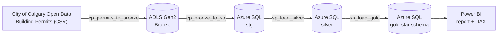

# Calgary Housing Permits: Did Rezoning Change What Gets Built?

An end-to-end Azure data pipeline and Power BI report that uses City of Calgary building permit data to measure how new housing supply changed across three policy periods: before citywide rezoning, during it, and after its repeal.

**[View the live dashboard](PASTE_PUBLISH_TO_WEB_LINK_HERE)**


---

## The business problem

Calgary changed its zoning rules twice in two years to address the housing crisis. Planners and council need evidence of how these changes affected the **number, type and location** of new homes being permitted.

- **Primary stakeholder:** City of Calgary Planning & Development
- **Secondary:** builders and developers deciding where to invest

The three policy periods give a natural before / during / after comparison:

| Period | Dates |
|---|---|
| Pre-rezoning | Jan 1, 2022 – Aug 5, 2024 |
| Citywide rezoning | Aug 6, 2024 – Aug 3, 2026 |
| Post-repeal | Aug 4, 2026 – latest load |

### Questions the report answers

1. How many new housing units were permitted per month in each period?
2. Did average monthly units rise after rezoning, and fall after the repeal?
3. What share of new units was each housing type in each period?
4. Did the missing-middle share rise during rezoning?
5. Which communities gained the most missing-middle units?

---

## Key findings

| | Pre-rezoning | Citywide rezoning | Post-repeal (early) |
|---|---|---|---|
| Avg new units per month | 1,504 | 2,020 | 1,839 |
| Change vs pre-rezoning | – | **+34%** | +22% |
| Missing-middle share of units | 22.1% | 23.5% | – |

- **Supply rose by about a third during rezoning.** Average monthly units went from 1,504 to 2,020. The first post-repeal months (1,839/month) are still above the pre-rezoning baseline, but this covers only a few months, so treat it as an early indicator.
- **Apartments added the most units; secondary suites nearly doubled.** Apartments rose from 578 to 793 units a month, the largest single increase. Secondary suites went from 130 to 253 a month. Single-detached grew slightly in units but its share fell from about 24% to about 20%.
- **Missing-middle units grew 43%, but their share barely moved.** Missing-middle units went from about 333 to 475 a month, but because every housing type grew, their share only rose from 22.1% to 23.5%.
- **Missing-middle homes cluster in new suburbs.** Rangeview leads with 538 missing-middle units. Bowness is the only established community in the top 10; the other nine are new suburbs.

---

## Architecture



Azure Data Factory (`adf-calgary-permits`) orchestrates every step in one pipeline, `pl_ingest_bronze`:

| # | Activity | Type | What it does |
|---|---|---|---|
| 1 | `cp_permits_to_bronze` | Copy | Downloads the full permits CSV from the City API into ADLS Gen2 (`bronze/building_permits/building_permits.csv`) |
| 2 | `cp_bronze_to_stg` | Copy | Loads the CSV into `stg.building_permits_raw` in Azure SQL, all columns as text |
| 3 | `sp_load_silver` | Stored procedure | Runs `silver.usp_load_building_permits`: types, cleans and dedupes |
| 4 | `sp_load_gold` | Stored procedure | Runs `gold.usp_load_gold`: filters, classifies housing type, rebuilds the star schema |

Datasets: `ds_http_permits_csv`, `ds_adls_bronze_permits`, `ds_sql_stg_permits`

**Why stored procedures instead of ADF Data Flows?** Data Flows run on Spark clusters that burn through credits. T-SQL stored procedures do the same transformations at no extra cost.

### What happens in each layer

| Layer | Where | What it holds |
|---|---|---|
| **Bronze** | ADLS Gen2 | Raw CSV exactly as downloaded, for a full audit trail |
| **Staging** | Azure SQL `stg` | Raw rows loaded as text (`NVARCHAR(MAX)`), no rules applied |
| **Silver** | Azure SQL `silver` | One clean, typed row per permit: dates converted, numbers cast, text trimmed, blanks set to NULL, geometry columns dropped |
| **Gold** | Azure SQL `gold` | Star schema filtered to housing permits issued from 2022 onward, with policy periods and housing types |

---

## Data model


**Grain:** one building permit that creates housing (`housing_units > 0`), issued on or after Jan 1, 2022.

| Table | Purpose |
|---|---|
| `fact_permit` | One row per permit: housing units, estimated cost, location |
| `dim_date` | Daily calendar with `policy_period` and an `is_complete_month` flag so partial months don't distort averages |
| `dim_housing_type` | 9 housing types derived from permit class codes, with a missing-middle flag |
| `dim_community` | One clean name per community code, plus coordinates for the map |
| `dim_contractor` | Standardized contractor names |

Blank communities and contractors map to an `Unknown` member (key `-1`) so no permit is dropped. The report analyzes permits by **issued date**.

### Housing types and the missing-middle definition

Housing type is assigned from the first four digits of `PermitClass`:

| Housing type | Permit class codes | Missing middle? |
|---|---|---|
| Single Detached | 1106, 1108 | No |
| Secondary Suite | 1110, 1111, 1112 | No |
| Backyard Suite | 1113, 1114 | No |
| Semi-Detached / Duplex | 1406, 1407, 1408 | **Yes** |
| Townhouse | 1606 | **Yes** |
| Rowhouse | 1706 | **Yes** |
| Triplex / Fourplex | 1507, 1508 | **Yes** |
| Apartment | 1502, 1506 | No |
| Other / Unspecified | everything else | No |

Suites are tracked separately rather than counted as missing middle, because they add a unit to a single-detached lot rather than creating a new ground-oriented multi-unit building.

---

## Power BI report

| Page | What it shows |
|---|---|
| **1. Supply** | Months in each period, % change vs pre-rezoning, and the monthly units trend with each period's average line |
| **2. Mix** | Missing-middle share by period and average monthly units by housing type, rezoning vs pre-rezoning |
| **3. Where** | Top 10 communities for missing-middle units and a 3D map of where they are |


### Key DAX measures

| Measure | Purpose |
|---|---|
| `Units` | Total new housing units |
| `Period Months` | Number of months in the selected period; months split by a policy date are shared by days |
| `Avg Monthly Units` | Units ÷ months, so periods of different length compare fairly |
| `% Change vs Pre-Rezoning` | Period average vs the pre-rezoning average |
| `Missing Middle Units` / `Missing Middle Share %` | Missing-middle units and their share of all units |
| `MM Monthly Change vs Pre` | Change in missing-middle monthly units vs pre-rezoning |
| `Period Average Line` / `Post Repeal Line` | Reference lines on the trend chart |
| `Bar Color` / `Hero Subtitle` | Dynamic formatting and headline text |

**Why averages, not totals:** the periods differ in length (31 months vs 24 months vs a few months), so raw totals would mislead.

---

## Data quality checks

Validation queries run after each load ([`sql/05_validation_checks.sql`](sql/05_validation_checks.sql)). Results from the Nov 9, 2026 load:

| Check | Result |
|---|---|
| Rows read by ADF = rows in staging | 503,585 = 503,585 |
| Silver rows / duplicate permits | 503,585 / 0 |
| Cost values that failed conversion | 0 (39,120 were blank in the source) |
| Gold permits / housing units | 47,249 / 100,986 |
| Gold units = Silver units for the same filter | Match |
| Orphan dates / unknown communities | 0 / 0 |
| Unknown contractors | 10,666, mostly secondary suites and unspecified work (typically homeowner-led) |

---

## Challenges and decisions

- **Lost Microsoft Fabric access mid-project.** The school's Fabric access was cut off, so I rebuilt the pipeline on Azure Data Factory and Azure SQL Database.
- **Keeping costs at zero.** I used the Azure SQL free offer and T-SQL stored procedures instead of Spark-based Data Flows. The pipeline is run manually instead of on a schedule to stay within the free tier.
- **Messy source types.** Dates arrive as `yyyy/mm/dd` text and numbers as text, so Silver uses `TRY_CONVERT` (style 111) and `TRY_CAST`. Failed conversions become NULL and are counted by the validation checks rather than crashing the load.
- **Months that straddle a policy date.** August 2024 and August 2026 fall in two periods, so months are split between periods by day count.

## Limitations

- **Permits lag policy.** Building permits follow development permits, so policy effects show up months after each effective date.
- **Short post-repeal window.** Only a few months of data, so post-repeal results are early indicators.
- **Derived housing type.** Based on permit class codes only; a small share falls into Other / Unspecified.
- **Light contractor cleaning.** Names are uppercased and trimmed, but suffixes like LTD and INC are not removed, so the same builder can appear twice.
- **Neutral framing.** Rezoning is politically contested. The report shows what changed, not whether the policy was right.

## Future enhancements

- Weekly ADF schedule trigger for automatic refresh
- Units per capita by community (needs a population dataset)
- Established vs new community classification
- Construction value per unit and approval time
- Stronger contractor name matching (remove legal suffixes)

---

## Repository structure

```
├── README.md
├── adf/
│   └── pl_ingest_bronze.json          # pipeline definition
├── sql/
│   ├── 01_create_schemas.sql
│   ├── 02_silver_building_permits.sql
│   ├── 03_gold_tables.sql
│   ├── 04_gold_load.sql
│   └── 05_validation_checks.sql
├── powerbi/
│   └── Dashboard.pbix
└── images/
    ├── page1_supply.png
    ├── page2_mix.png
    ├── page3_where.png
    └── data_model.png
```

## How to run it

1. Create a resource group with ADLS Gen2, an Azure SQL Database and an Azure Data Factory.
2. Run the scripts in `sql/` in order (01 to 04) to create the schemas, tables and procedures.
3. Import the pipeline from `adf/` and point the linked services at your storage account and database.
4. Trigger `pl_ingest_bronze`, then run `05_validation_checks.sql`.
5. Open `powerbi/Dashboard.pbix` and update the data source to your database.

## Tech stack

Azure Data Factory · ADLS Gen2 · Azure SQL Database · T-SQL (CTEs, window functions, stored procedures) · Power BI · DAX · Azure Maps visual

## Data source

[City of Calgary Building Permits](https://data.calgary.ca/Business-and-Economic-Activity/Building-Permits/c2es-76ed) (dataset `c2es-76ed`), published by City of Calgary Planning & Development under the Open Government Licence – City of Calgary.

---

**Eleni Liyew** · [LinkedIn](https://www.linkedin.com/in/eleni-liyew) · [GitHub](https://github.com/eleni26)
